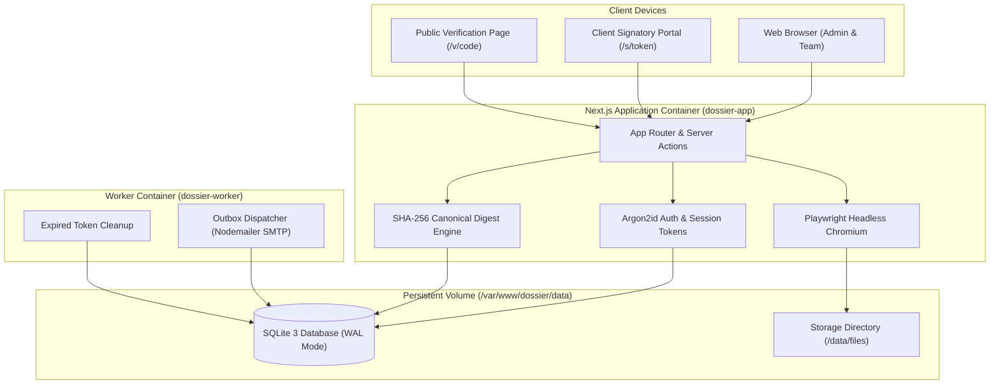

<div align="center">

<a href="https://github.com/red-shadows-rs/dossier">
  
</a>

# Dossier

Contracts & invoices platform with cryptographic verification, automated milestone billing, and bidirectional Arabic/English PDF rendering.

[](CHANGELOG.md)
[](LICENSE)


</div>

---

## Language

<a href="README.md">🇬🇧 English</a> · <a href="README_AR.md">🇸🇦 العربية</a>

---

## Table of Contents

- [Overview](#overview)
- [Live Demo](#live-demo)
- [Comparison](#comparison)
- [Key Features](#features)
- [System Architecture](#architecture)
- [Tech Stack](#tech-stack)
- [Project Structure](#project-structure)
- [Requirements](#requirements)
- [Quick Start](#quick-start)
- [Available Commands](#commands)
- [Cryptographic Verification](#verification)
- [Documentation](#documentation)
- [Contributing](#contributing)
- [License](#license)

---

<a id="live-demo"></a>
## Live Demo

Experience Dossier in a fully functional, interactive sandbox pre-populated with bilingual clients, contracts, payment milestones, and invoices:

<div align="center">

[](https://dossier.red-shadows-rs.com/demo)

**[Launch Live Demo](https://dossier.red-shadows-rs.com/demo)** (One-click instant login - no registration required)

</div>

---

<a id="overview"></a>
## Overview

**Dossier** is a self-hosted, all-in-one business management platform designed for software agencies, consultants, and enterprises. It replaces fragmented tools (DocuSign, FreshBooks, PandaDoc) with a unified **Project Dossier** model: each client project consolidates contracts, version-controlled clauses, digital signatures, payment schedules, milestone-driven invoices, file attachments, and an append-only audit trail.

Built from the ground up with **zero external SaaS dependencies**, Dossier runs entirely on your own infrastructure using Next.js App Router, SQLite, an embedded Chromium PDF engine, and an autonomous background SMTP queue worker.

---

<a id="comparison"></a>
## Comparison

| Capability | DocuSign | PandaDoc | FreshBooks | Wave | **Dossier** |
| :--- | :---: | :---: | :---: | :---: | :---: |
| Self-Hosted & Air-Gapped | ❌ SaaS | ❌ SaaS | ❌ SaaS | ❌ SaaS | ✅ Docker / Linux |
| Arabic RTL Native Typography | ⚠️ Basic | ⚠️ Basic | ❌ LTR only | ❌ LTR only | ✅ Cairo font & Full RTL |
| Milestone-to-Invoice Automation | ❌ | ⚠️ Manual | ✅ | ⚠️ Basic | ✅ Native binding |
| Cryptographic Verification Barcodes | ❌ Proprietary | ❌ | ❌ | ❌ | ✅ SHA-256 + Code39 + QR |
| Side-by-Side Bilingual Contracts | ❌ | ❌ | ❌ | ❌ | ✅ Arabic / English |
| Immutable Database Triggers | ❌ | ❌ | ❌ | ❌ | ✅ SQLite triggers |
| External Subscriptions Required | ❌ \$10-40/mo | ❌ \$19-49/mo | ❌ \$19-60/mo | ❌ Transaction fee | ✅ Free & Open Source (GPL-3.0) |

---

<a id="features"></a>
## Key Features

- **Unified Project Dossier:** Group contracts, payment milestones, invoices, receipts, and client contacts into a clean, single-pane project view.
- **Contract Builder & Lifecycle:** Draft contracts with dynamic variables (`{{client.name}}`, `{{contract.total}}`), counter-parties, payment schedules, and version control.
- **Bilingual Side-by-Side Layout:** Export contracts in Arabic, English, or synchronized bilingual columns with mirrored Cairo typography.
- **Milestone-Driven Invoicing:** Automatically generate tax invoices from contract milestones with a single click, eliminating billing errors.
- **Subscriptions & Scheduled Services:** Manage recurring client services (hosting, maintenance, retainers) with customizable billing intervals, automated invoice generation via background cron worker, and full lifecycle controls (pause/resume/cancel).
- **Multi-Currency & Dedicated Payment Accounts:** Support for multiple fiat and crypto payment rails (Binance networks/wallet/memo, PayPal merchant email/links, Saudi local banks) with localized currency selector (SAR, USD, EUR, etc.).
- **Cryptographic Tamper-Evidence:** Generates deterministic canonical JSON digests (SHA-256) upon signature; signed agreements are sealed with embedded vector Code39 barcodes and QR codes.
- **Public Verification Engine:** Anyone holding a document code or barcode can verify its historical authenticity at `/v/:code` or `/verify` without logging in.
- **Autonomous Background Worker:** Built-in queue worker dispatches outbox emails via SMTP with automatic exponential retries.
- **Role-Based Access Control:** Strict permission boundaries for `owner`, `member`, and `viewer` roles, protected with Argon2id and signed session cookies.

---

<a id="architecture"></a>
## System Architecture

Dossier operates as two decoupled services over a persistent SQLite database:



---

<a id="tech-stack"></a>
## Tech Stack

| Layer | Technology |
| :--- | :--- |
| **Framework** | Next.js 16 (App Router / Turbopack), React 19, TypeScript strict |
| **Database** | SQLite via `better-sqlite3` + Drizzle ORM |
| **Styling** | Tailwind CSS v4, Material UI (MUI v6 core), logical RTL utilities |
| **Typography** | Cairo font (bundled TrueType, offline, zero Google Fonts requests) |
| **PDF Rendering** | Playwright (Headless Chromium `page.pdf()`) |
| **Cryptography** | Node.js `crypto` (Argon2id, HMAC-SHA256, Canonical JSON SHA-256) |
| **Email Queue** | Nodemailer (SMTP) with autonomous background worker process |
| **Test Suite** | Vitest (unit & integration), Playwright (E2E) |

---

<a id="project-structure"></a>
## Project Structure

```
dossier/
├── assets/                     # Cairo fonts, brand SVG vectors
├── docs/                       # Specifications (Architecture, Deployment, API, Troubleshooting)
├── drizzle/                    # SQL migrations and schema snapshots
├── messages/                   # next-intl translations (ar.json, en.json)
├── nginx/                      # Production Nginx reverse proxy configuration
├── scripts/                    # CLI scripts (seed, user creation, worker, check-rtl, check-comments)
├── src/
│   ├── app/                    # App Router pages, layouts, and public verification routes
│   ├── components/             # Reusable UI components (forms, tables, dashboard, layout)
│   ├── db/                     # Drizzle ORM schema, triggers, and connection client
│   ├── lib/                    # Core utilities, Zod validation, crypto, and environment schemas
│   └── server/                 # Domain services (contracts, invoices, email, PDF engine)
├── tests/                      # Playwright end-to-end test suites
├── docker-compose.yml          # Production multi-container orchestration
├── Dockerfile                  # Multi-stage production container build
├── package.json                # Project dependencies and script runner
└── tsconfig.json               # Strict TypeScript configuration
```

---

<a id="requirements"></a>
## Requirements

- **Runtime:** Node.js >= 20.9 (Node 22 LTS recommended)
- **Package Manager:** npm >= 10
- **Database:** SQLite 3 (handled transparently via `better-sqlite3`)
- **Containerization (Optional):** Docker Engine >= 24.0, Docker Compose v2

---

<a id="quick-start"></a>
## Quick Start

### 1. Clone & Install

```bash
git clone https://github.com/red-shadows-rs/dossier.git
cd dossier
npm install
```

### 2. Environment Configuration

```bash
cp .env.example .env.local
# Generate APP_SECRET:
openssl rand -hex 32
```

Edit `.env.local` and set `APP_URL=http://localhost:3000` and `APP_SECRET=<generated_key>`.

### 3. Initialize Database & Seed

```bash
# Run database migrations
npm run db:migrate

# Seed bootstrap owner account
npm run seed
```

### 4. Start Development Server

```bash
npm run dev
```

Open [http://localhost:3000](http://localhost:3000) and sign in using the bootstrap credentials.

---

<a id="commands"></a>
## Available Commands

| Command | Description |
| :--- | :--- |
| `npm run dev` | Start development server with Turbopack |
| `npm run build` | Compile Next.js production build |
| `npm start` | Start standalone production server |
| `npm run worker` | Start background email queue worker |
| `npm run typecheck` | Run TypeScript compiler strict validation |
| `npm run lint` | Run ESLint static code analysis |
| `npm run check:rtl` | Validate RTL logical property compliance |
| `npm run check:comments` | Enforce code comment policy guard |
| `npm test` | Run Vitest unit and integration test suite |
| `npm run test:e2e` | Run Playwright end-to-end browser tests |
| `npm run db:migrate` | Execute pending database schema migrations |
| `npm run user:create` | CLI to create administrative and staff accounts |

---

<a id="verification"></a>
## Cryptographic Verification

Every signed contract contains a tamper-evident seal verified against its immutable database trigger:

```bash
# Test public verification endpoint via curl:
curl -I https://dossier.red-shadows-rs.com/v/DEMO-2026-X7K9
```

The endpoint returns `HTTP/2 200 OK` and presents the complete historical certificate, signatories, and SHA-256 hash.

<a id="documentation"></a>
## Documentation

| Document | Description |
|----------|-------------|
| [ARCHITECTURE.md](docs/ARCHITECTURE.md) | System topology, state machines, and cryptographic design |
| [DEPLOYMENT.md](docs/DEPLOYMENT.md) | Production Docker Compose, Nginx SSL reverse proxy, and backups |
| [API_SPEC.md](docs/API_SPEC.md) | Public verification routes, PDF streaming, and health checks |
| [TROUBLESHOOTING.md](docs/TROUBLESHOOTING.md) | Common diagnostic procedures and deployment fixes |

<a id="contributing"></a>
## Contributing

1. Fork the repository and create a branch (`feature/`, `fix/`, `docs/`, `chore/`).
2. Ensure all verification checks pass: `npm run check` (typecheck, lint, check-rtl, check-comments, tests).
3. Add a `CHANGELOG.md` entry.
4. Commit as `dossier | <type>: <description>` and open a pull request against `main`.

Read the [Contributing Guidelines](CONTRIBUTING.md) and the [Code of Conduct](CODE_OF_CONDUCT.md). Report problems through [GitHub Issues](https://github.com/red-shadows-rs/dossier/issues).

<a id="license"></a>
## License

Distributed under the [GPL-3.0 License](LICENSE).

---

<div align="center">

Built by <a href="https://github.com/red-shadows-rs">RED SHADOWS | RS</a> (<a href="https://github.com/shadow-x78">shadow-x78</a>) ·
[Changelog](CHANGELOG.md) ·
[Security](SECURITY.md)

<sub>&copy; 2026 Dossier - RED SHADOWS | RS (shadow-x78)</sub>

</div>
