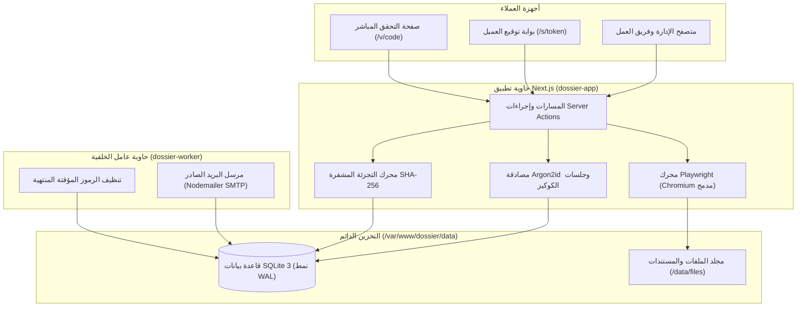

<div align="center">

<a href="https://github.com/red-shadows-rs/dossier">
  
</a>

# Dossier

منصة متكاملة لإدارة العقود والفواتير مع التوثيق المشفر، الجدولة الآلية للدفعات، وتوليد ملفات PDF ثنائية اللغة (عربي / إنجليزي).

[](CHANGELOG.md)
[](LICENSE)


</div>

---

## اللغة

<a href="README.md">🇬🇧 English</a> · <a href="README_AR.md">🇸🇦 العربية</a>

---

## فهرس المحتويات

- [نظرة عامة](#نظرة-عامة)
- [التجربة الحية (ديمو مباشر)](#التجربة-الحية)
- [المقارنة](#المقارنة)
- [المزايا الرئيسية](#المزايا-الرئيسية)
- [معمارية النظام](#معمارية-النظام)
- [حزمة التقنيات](#حزمة-التقنيات)
- [هيكل المشروع](#هيكل-المشروع)
- [متطلبات التشغيل](#متطلبات-التشغيل)
- [التثبيت والتشغيل السريع](#التثبيت-والتشغيل-السريع)
- [الأوامر المتاحة](#الأوامر-المتاحة)
- [نظام التوثيق المشفر](#نظام-التوثيق-المشفر)
- [التوثيق التفصيلي](#التوثيق-التفصيلي)
- [المساهمة](#المساهمة)
- [الرخصة](#الرخصة)

---

<a id="التجربة-الحية"></a>
## التجربة الحية (ديمو مباشر)

جرب منصة Dossier بشكل فوري وتفاعلي مع بيانات نموذجية مهيأة مسبقاً للعقود، مراحل الدفع، والفواتير الضريبية:

<div align="center">

[](https://dossier.red-shadows-rs.com/demo)

**[بدء التجربة المباشرة](https://dossier.red-shadows-rs.com/demo)** (تسجيل دخول فوري بنقرة واحدة - دون الحاجة لبيانات اعتماد)

</div>

---

<a id="نظرة-عامة"></a>
## نظرة عامة

**Dossier** هي منصة أعمال مستضافة ذاتياً بالكامل مخصصة للشركات البرمجية، وكالات الاستشارات، والمستقلين. تحل المنصة محل الأدوات المتفرقة باهظة التكلفة (مثل DocuSign وPandaDoc وFreshBooks) عبر نموذج **ملف المشروع (Project Dossier)** الموحد: حيث يجمع كل مشروع تعاقدي بين مسودات العقود المتسلسلة زمنياً، التوقيع الرقمي، جداول الدفع، الفواتير المرتبطة بالمراحل، المرفقات، وسجل التدقيق التاريخي.

صُممت المنصة وفق مبدأ **الاستقلالية التامة عن أي خدمات سحابية خارجية (Zero SaaS Dependencies)**، وتعمل كلياً على بنيتك التحتية الخاصة باستخدام Next.js App Router، قاعدة بيانات SQLite السريعة، محرك PDF مبني على Chromium داخلي، وعامل خلفي لإرسال البريد عبر خوادم SMTP.

---

<a id="المقارنة"></a>
## المقارنة

<div dir="rtl" align="right">

| الإمكانية | DocuSign | PandaDoc | FreshBooks | Wave | **Dossier** |
| :--- | :---: | :---: | :---: | :---: | :---: |
| استضافة ذاتية كاملة (Self-Hosted) | ❌ خدمة سحابية | ❌ خدمة سحابية | ❌ خدمة سحابية | ❌ خدمة سحابية | ✅ Docker / Linux |
| خط عربي أصيل ودعم RTL كامل | ⚠️ بسيط | ⚠️ بسيط | ❌ LTR فقط | ❌ LTR فقط | ✅ خط Cairo ودعم أصيل |
| تحويل مراحل الدفع لفواتير آلياً | ❌ | ⚠️ يدوي | ✅ | ⚠️ أساسي | ✅ ربط مباشر |
| باركودات توثيق مشفرة (SHA-256) | ❌ مغلق | ❌ | ❌ | ❌ | ✅ SHA-256 + Code39 + QR |
| عقود ثنائية اللغة جنباً إلى جنب | ❌ | ❌ | ❌ | ❌ | ✅ عربي / إنجليزي |
| قفل العقود الموقعة بقواعد البيانات | ❌ | ❌ | ❌ | ❌ | ✅ SQLite triggers |
| اشتراكات شهرية ورسوم إضافية | ❌ \$10-40/شهرياً | ❌ \$19-49/شهرياً | ❌ \$19-60/شهرياً | ❌ رسوم معاملات | ✅ مجاني ومفتوح المصدر (GPL-3.0) |

</div>

---

<a id="المزايا-الرئيسية"></a>
## المزايا الرئيسية

- **الملف التعاقدي الموحد (Project Dossier):** جمع العقود، مراحل الدفع، الفواتير، سندات القبض، وبيانات العميل في لوحة تفاعلية واحدة.
- **صانع العقود ودورة الحياة:** صياغة العقود بمتغيرات ديناميكية (`{{client.name}}`، `{{contract.total}}`)، وإدارة الممثلين، وجداول السداد.
- **التصميم المزدوج جنبًا إلى جنب:** تصدير العقود باللغة العربية أو الإنجليزية أو في عمودين متجاورين متزامنين بخط Cairo الموزون.
- **الفوترة الذكية المعتمدة على المراحل:** تحويل أي مرحلة إنجاز تعاقدية إلى فاتورة ضريبية رسمية بنقرة زر واحدة.
- **إدارة الاشتراكات والخدمات المجدولة:** إدارة الخدمات الدورية (الاستضافة السحابية، عقود الصيانة، الخدمات الدورية) مع فترات فوترة مرنة، وتوليد الفواتير آلياً عبر خادم المهام المجدولة، ودعم كامل للتحكم بدورة حياة الاشتراك (إيقاف مؤقت / استئناف / إلغاء).
- **تعدد العملات والحسابات المخصصة:** دعم بوابات وحسابات تحويل مخصصة لمنصات العملات الرقمية (شبكات ومحافظ ومذكرات Binance) وحسابات PayPal مع محدد ديناميكي للعملات ورموزها (ريال، دولار، يورو، وغيرها).
- **الحماية الجنائية من التلاعب:** احتساب بصمة معيارية (SHA-256 Canonical Digest) فور اكتمال التوقيع، وتثبيت باركود Code39 ورمز QR يوجه لصفحة التحقق.
- **بوابة التحقق المفتوحة:** يمكن لأي جهة تفقد صحة الوثيقة وتفاصيل الموقعين عبر زيارة الرابط `/v/:code` أو مسح الباركود دون الحاجة لتسجيل دخول.
- **عامل معالجة خلفي مستقل:** خادم معالجة يعمل تلقائياً لإرسال البريد عبر SMTP مع جدولة ذكية لإعادة المحاولة.
- **صلاحيات وصول دقيقة:** فئات مستخدمين متعددة (`owner`، `member`، `viewer`) محمية بتشفير Argon2id وجلسات آمنة مشفرة.

---

<a id="معمارية-النظام"></a>
## معمارية النظام

يعمل النظام عبر حاويتين متكاملتين تتشاركان قاعدة بيانات SQLite ومجلد التخزين:



---

<a id="حزمة-التقنيات"></a>
## حزمة التقنيات

<div dir="rtl" align="right">

| الطبقة | التقنية المستخدمة |
| :--- | :--- |
| **إطار العمل** | Next.js 16 (App Router / Turbopack)، React 19، TypeScript strict |
| **قاعدة البيانات** | SQLite عبر `better-sqlite3` و Drizzle ORM |
| **التنسيق والتصميم** | Tailwind CSS v4، Material UI (MUI v6 core)، خصائص RTL المنطقية |
| **الخطوط والطباعة** | خط Cairo المدمج محلياً (TrueType، يعمل دون إنترنت كلياً) |
| **توليد PDF** | Playwright عبر متصفح Chromium المدمج (`page.pdf()`) |
| **التشفير والتحقق** | Node.js `crypto` (تشفير Argon2id، تجزئة HMAC-SHA256، وبصمة Canonical JSON) |
| **طابور البريد** | Nodemailer (SMTP) مع عامل معالجة مستقل في الخلفية |
| **حزمة الفحص** | Vitest (اختبارات الوحدة والتكامل)، Playwright (اختبارات e2e للمتصفح) |

</div>

---

<a id="هيكل-المشروع"></a>
## هيكل المشروع

```
dossier/
├── assets/                     # خطوط Cairo ومتجهات العلامة التجارية SVG
├── docs/                       # الوثائق والمواصفات (المعمارية، النشر، API، استكشاف الأخطاء)
├── drizzle/                    # ترحيلات SQL ولقطات المخطط
├── messages/                   # ملفات الترجمة لـ next-intl (ar.json، en.json)
├── nginx/                      # إعدادات Nginx الوسيط للإنتاج
├── scripts/                    # سكريبتات الإدارة (seed، إنشاء مستخدم، العامل، فحص RTL، فحص التعليقات)
├── src/
│   ├── app/                    # صفحات ومسارات App Router وصفحات التحقق العامة
│   ├── components/             # مكونات الواجهة (النماذج، الجداول، لوحة المعلومات)
│   ├── db/                     # مخطط Drizzle ORM، المشغلات Triggers، وعميل الاتصال
│   ├── lib/                    # الأدوات المساعدة، التحقق بـ Zod، التشفير، ومخططات البيئة
│   └── server/                 # خدمات المنطق التجاري (العقود، الفواتير، البريد، محرك PDF)
├── tests/                      # اختبارات Playwright الشاملة للمتصفح
├── docker-compose.yml          # إدارة الحاويات في بيئة الإنتاج
├── Dockerfile                  # بناء صورة الإنتاج متعددة المراحل
├── package.json                # الحزم البرمجية والأوامر
└── tsconfig.json               # إعدادات TypeScript الصارمة
```

---

<a id="متطلبات-التشغيل"></a>
## متطلبات التشغيل

- **بيئة التشغيل:** Node.js >= 20.9 (يوصى بـ Node 22 LTS)
- **مدير الحزم:** npm >= 10
- **قاعدة البيانات:** SQLite 3 (تدار تلقائياً عبر `better-sqlite3`)
- **الحاويات (اختياري):** Docker Engine >= 24.0, Docker Compose v2

---

<a id="التثبيت-والتشغيل-السريع"></a>
## التثبيت والتشغيل السريع

### 1. استنساخ المستودع وتثبيت الاعتماديات

```bash
git clone https://github.com/red-shadows-rs/dossier.git
cd dossier
npm install
```

### 2. ضبط متغيرات البيئة

```bash
cp .env.example .env.local
# توليد مفتاح التشفير APP_SECRET:
openssl rand -hex 32
```

قم بفتح `.env.local` وضبط `APP_URL=http://localhost:3000` و `APP_SECRET=<المفتاح_المولد>`.

### 3. ترحيل قاعدة البيانات والحساب الأولي

```bash
# تشغيل ترحيلات المخطط
npm run db:migrate

# إنشاء حساب المالك الأولي
npm run seed
```

### 4. تشغيل خادم التطوير

```bash
npm run dev
```

افتح الرابط [http://localhost:3000](http://localhost:3000) وسجل الدخول باستخدام بيانات الحساب الأولي.

---

<a id="الأوامر-المتاحة"></a>
## الأوامر المتاحة

<div dir="rtl" align="right">

| الأمر | الوصف |
| :--- | :--- |
| `npm run dev` | تشغيل خادم التطوير مع Turbopack |
| `npm run build` | بناء نسخة الإنتاج المجمعة من Next.js |
| `npm start` | تشغيل خادم الإنتاج المستقل |
| `npm run worker` | تشغيل عامل معالجة طابور البريد في الخلفية |
| `npm run typecheck` | تشغيل فحص الأنواع الصارم بـ TypeScript |
| `npm run lint` | تشغيل فحص جودة الكود بـ ESLint |
| `npm run check:rtl` | فحص التوافق مع خصائص الاتجاه المنطقية RTL |
| `npm run check:comments` | تشغيل حارس سياسة التعليقات البرمجية |
| `npm test` | تشغيل اختبارات الوحدة والتكامل بـ Vitest |
| `npm run test:e2e` | تشغيل اختبارات المتصفح الشاملة بـ Playwright |
| `npm run db:migrate` | تطبيق ترحيلات قاعدة البيانات المعلقة |
| `npm run user:create` | إنشاء حسابات للموظفين والمديرين عبر الطرفية |

</div>

---

<a id="verification"></a>
## نظام التوثيق المشفر

يحمل كل عقد موقع ختماً جنائياً محمياً بمشغلات قاعدة البيانات غير القابلة للاختراق:

```bash
# اختبار صفحة التحقق العامة عبر curl:
curl -I https://dossier.red-shadows-rs.com/v/DEMO-2026-X7K9
```

تستجيب المنصة بـ `HTTP/2 200 OK` وتعرض شهادة الإتمام التاريخية الكاملة وأطراف التوقيع وبصمة SHA-256.

<a id="documentation"></a>
## التوثيق

<div dir="rtl" align="right">

| الوثيقة | الوصف |
| :--- | :--- |
| [ARCHITECTURE_AR.md](docs/ARCHITECTURE_AR.md) | معمارية النظام، آلة الحالات، ونظام التوثيق المشفر |
| [DEPLOYMENT_AR.md](docs/DEPLOYMENT_AR.md) | دليل النشر عبر Docker و Nginx والنسخ الاحتياطي |
| [API_SPEC_AR.md](docs/API_SPEC_AR.md) | مواصفات واجهات البرمجة العامة ومسارات التحقق وتوليد PDF |
| [TROUBLESHOOTING_AR.md](docs/TROUBLESHOOTING_AR.md) | استكشاف الأخطاء الشائعة وحلول التشغيل |

</div>

<a id="contributing"></a>
## المساهمة

1. اعمل Fork للمستودع وأنشئ فرعاً مناسباً: `feature/` أو `fix/` أو `docs/` أو `chore/`.
2. تأكد من اجتياز كافة الفحوصات: `npm run check` (typecheck, lint, check-rtl, check-comments, tests).
3. أضف قيداً في `CHANGELOG.md`.
4. أنشئ الكوميت بصيغة `dossier | <type>: <description>` وافتح Pull Request نحو فرع `main`.

راجع [إرشادات المساهمة](CONTRIBUTING.md) و[ميثاق السلوك](CODE_OF_CONDUCT.md). وأبلغ عن أي مشكلة عبر [GitHub Issues](https://github.com/red-shadows-rs/dossier/issues).

<a id="license"></a>
## الرخصة

مرخّص تحت [رخصة GPL-3.0](LICENSE).

---

<div align="center">

تم التطوير بواسطة <a href="https://github.com/red-shadows-rs">RED SHADOWS | RS</a> (<a href="https://github.com/shadow-x78">shadow-x78</a>) ·
[سجل التغييرات](CHANGELOG.md) ·
[الأمان](SECURITY.md)

<sub>&copy; 2026 Dossier - RED SHADOWS | RS (shadow-x78)</sub>

</div>

