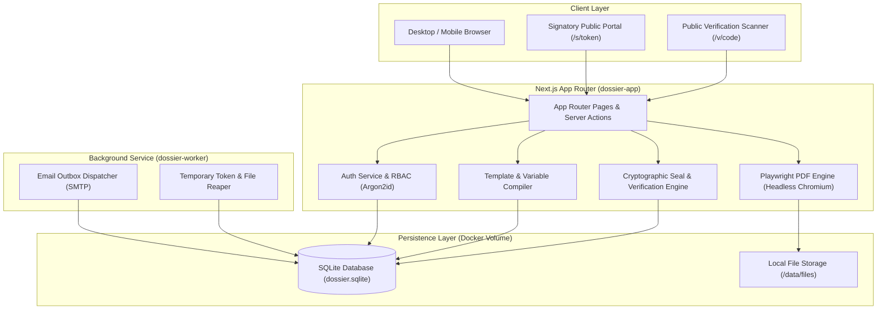
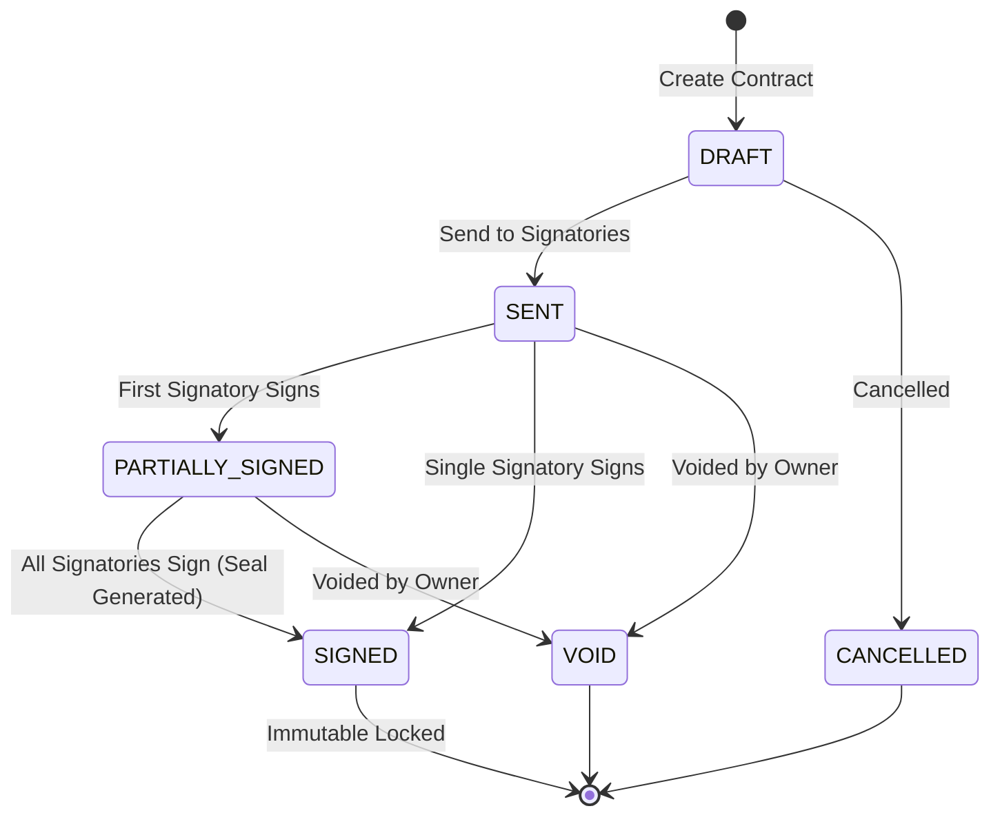
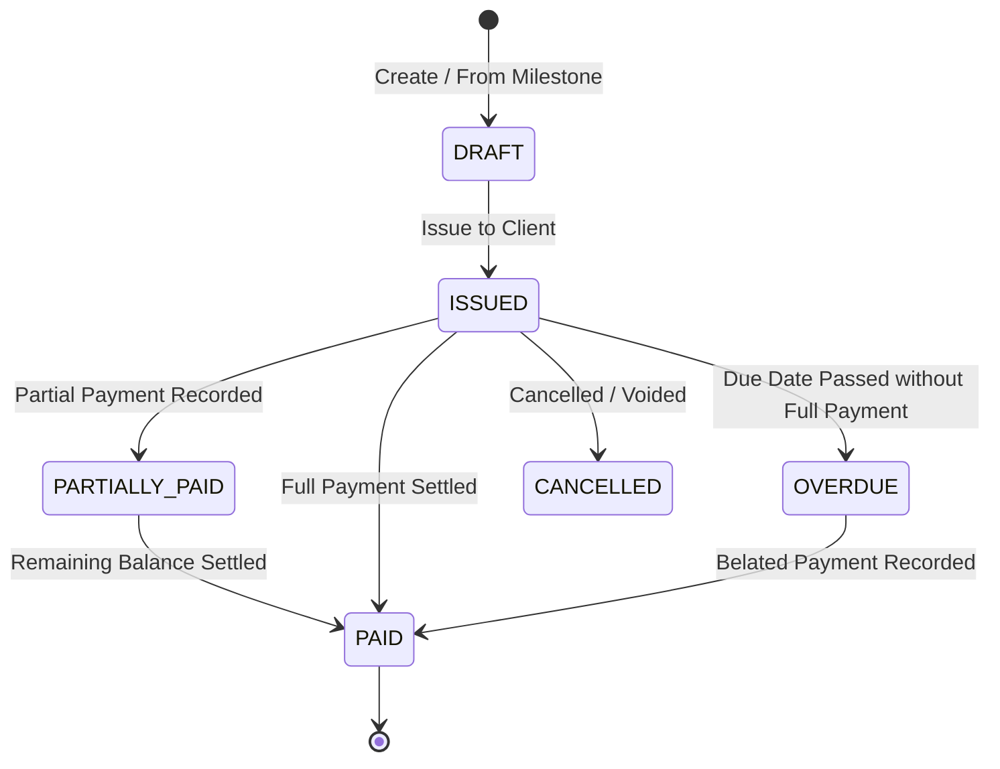

<div align="center">

# Architecture Specification - Dossier

[](../CHANGELOG.md)
[](../LICENSE)


</div>

---

## Language

<a href="ARCHITECTURE.md">🇬🇧 English</a> · <a href="ARCHITECTURE_AR.md">🇸🇦 العربية</a>

---

Dossier is an all-in-one contracts and invoicing management system built for agencies, freelancers, and businesses. It unifies client dossiers, milestone-based contract lifecycle management, digital signatures, bilingual PDF rendering, and cryptographic verification within a lightweight, self-hosted Next.js and SQLite architecture.

---

## Table of Contents

- [Core Principles](#core-principles)
- [System Architecture Overview](#system-architecture-overview)
- [Project Dossier Hierarchy](#project-dossier-hierarchy)
- [Contract State Machine](#contract-state-machine)
- [Invoice & Milestone Lifecycle](#invoice--milestone-lifecycle)
- [Cryptographic Verification Architecture](#cryptographic-verification-architecture)
- [PDF Rendering Engine](#pdf-rendering-engine)
- [Asynchronous Background Queue](#asynchronous-background-queue)
- [Internationalization & RTL Engine](#internationalization--rtl-engine)
- [Database Schema Design](#database-schema-design)

---

<a id="core-principles"></a>
## Core Principles

1. **Zero External SaaS Dependencies:** Completely self-hosted; SQLite database, local file storage, headless Chromium PDF engine, and built-in background SMTP worker.
2. **First-Class Arabic & English (Bilingual):** Built from day one with RTL-first layouts, Cairo typography, and side-by-side contract bilingual mirroring.
3. **Cryptographic Tamper-Evidence:** Immutable signed contracts, canonical JSON digests, SHA-256 integrity verification, and Code39/QR barcodes.
4. **Deterministic Milestone-to-Invoice Pipelines:** Contract milestones dynamically convert into trackable tax invoices with zero duplicate entry.

---

<a id="system-architecture-overview"></a>
## System Architecture Overview

The system consists of two primary operational units: the web application (`dossier-app`) and the background queue worker (`dossier-worker`), both operating against a shared SQLite database and persistent file volume.



---

<a id="project-dossier-hierarchy"></a>
## Project Dossier Hierarchy

At the core of the system is the **Dossier concept**: every business engagement is bound to a Project Dossier that aggregates all related entities:

```
Client
  └── Project (Dossier)
        ├── Contracts (v1, v2, ... vn)
        │     ├── Signatories
        │     ├── Payment Milestones
        │     └── Version Snapshots (Canonical JSON)
        ├── Invoices
        │     ├── Line Items (from Milestones or Custom)
        │     ├── Payments (Bank transfer, cash, card)
        │     └── Receipts
        ├── Files & Attachments
        └── Audit Trail (Historical Log)
```

---

<a id="contract-state-machine"></a>
## Contract State Machine

Contracts transition through strict, predictable states enforced by both application logic and database triggers:



- **DRAFT:** Clauses and milestone payments are editable; new versions can be drafted.
- **SENT:** Invitation emails dispatched with HMAC-protected tokens; signatories review the document.
- **SIGNED:** Terminal state. An SQLite database trigger `BEFORE UPDATE` forbids any modification to the contract, versions, or signatories once signed. A cryptographic verification seal is generated and stamped onto the PDF certificate.

---

<a id="invoice--milestone-lifecycle"></a>
## Invoice & Milestone Lifecycle

Invoices can be created independently or generated automatically from contract payment milestones:



---

<a id="cryptographic-verification-architecture"></a>
## Cryptographic Verification Architecture

Dossier provides bank-grade tamper detection for all executed contracts:

1. **Deterministic JSON Serialization:**
   All version fields (title, body clauses, payment milestones, amounts, currencies) are sorted lexicographically, normalized for whitespace, and serialized via `canonicalJson()`.
2. **SHA-256 Content Digest:**
   `SHA256(canonicalJson)` produces a 64-character hexadecimal digest representing the unalterable terms of the contract.
3. **Verification Code & Barcodes:**
   When all parties sign, the system calculates a public verification token and renders:
   - **Code39 Barcode:** Vector SVG embedded into the footer and certificate page.
   - **QR Code:** Vector SVG linking directly to `https://<domain>/v/<verification_code>`.
4. **Independent Public Verification:**
   Visitors can inspect `/verify` or scan the QR code to view the tamper-evident certificate showing the signatories, timestamps, and matching SHA-256 digest.

---

<a id="pdf-rendering-engine"></a>
## PDF Rendering Engine

Dossier utilizes an internal Headless Chromium browser managed by Playwright:
- Renders HTML/CSS templates styled precisely to A4 dimensions (`210mm x 297mm`).
- Generates vector-sharp text using the bundled **Cairo font** for both Arabic and Latin scripts.
- Implements continuous page balancing, running headers/footers, and page counters (`Page X of Y`).
- Fully isolated in Linux user namespaces without external web fonts or scripts.

---

<a id="asynchronous-background-queue"></a>
## Asynchronous Background Queue

The queue worker (`scripts/worker.ts`) operates autonomously to process outbox emails:
- **Zero Redis Dependency:** Backed by SQLite table `email_outbox` with row-level leasing.
- **Exponential Backoff:** Retries failed SMTP transmissions up to 5 times (`10s`, `30s`, `2m`, `10m`, `30m`).
- **Audit Integration:** Successes and fatal failures are recorded into `audit_log`.

---

<a id="internationalization--rtl-engine"></a>
## Internationalization & RTL Engine

- **Default Locale:** Arabic (`ar`), with complete English (`en`) support.
- **Logical Directionality:** Strictly enforced logical CSS utilities (`ms-*`, `me-*`, `ps-*`, `pe-*`, `start-*`, `end-*`).
- **Cookie-Based Persistence:** Clean URLs without locale prefixes (`/contracts`, `/invoices`).

---

<div align="center">

Built by <a href="https://github.com/red-shadows-rs">RED SHADOWS | RS</a> (<a href="https://github.com/shadow-x78">shadow-x78</a>) ·
[Back to README](../README.md)

<sub>&copy; 2026 Dossier - RED SHADOWS | RS (shadow-x78)</sub>

</div>

