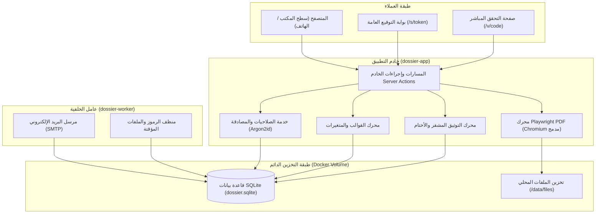
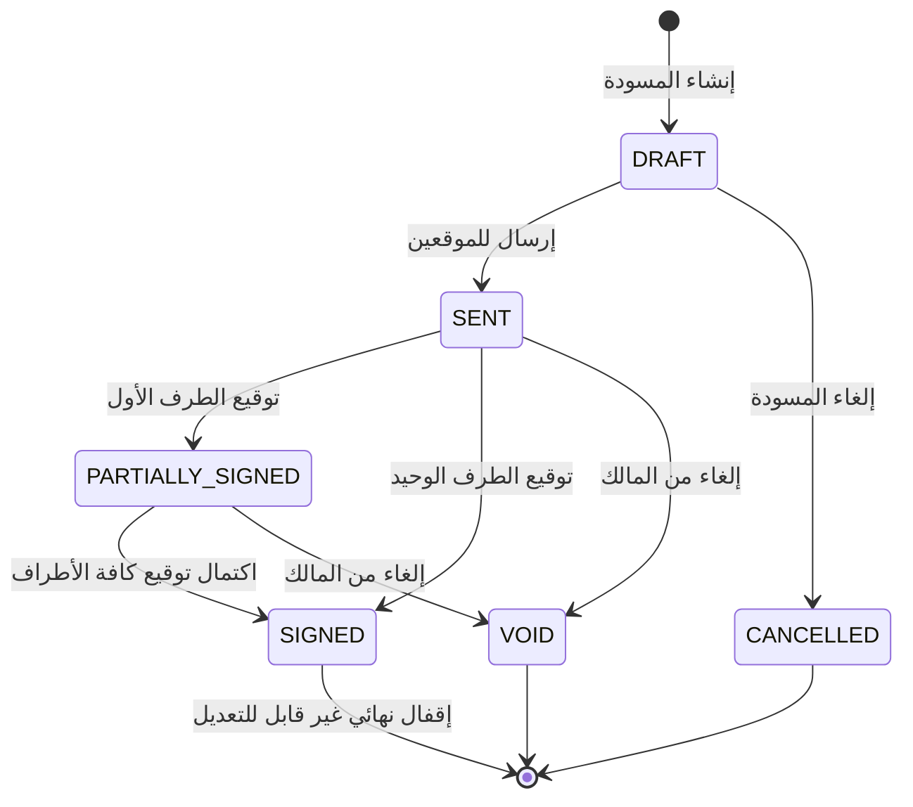
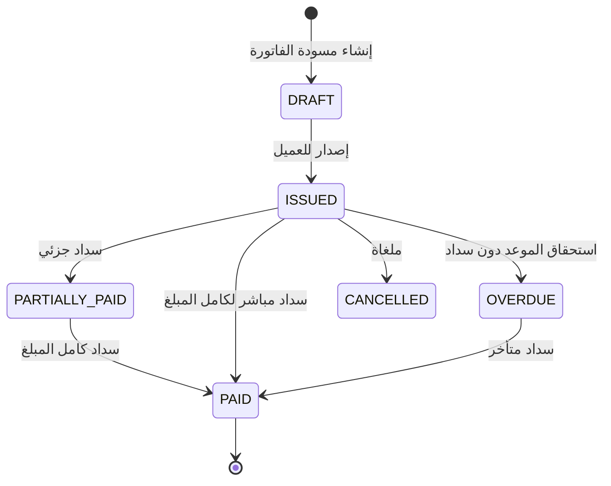

<div align="center">

# مواصفات المعمارية - Dossier

[](../CHANGELOG.md)
[](../LICENSE)


</div>

---

## اللغة

<a href="ARCHITECTURE.md">🇬🇧 English</a> · <a href="ARCHITECTURE_AR.md">🇸🇦 العربية</a>

---

نظام Dossier هو منصة متكاملة لإدارة العقود والفواتير للشركات والمستقلين، تجمع بين إدارة ملفات العملاء، دورة حياة العقود والمراحل المالية، التوقيع الرقمي، وتوليد ملفات PDF ثنائية اللغة وتوثيقها مشفراً، بالاعتماد على Next.js وSQLite باستضافة ذاتية مستقلة بالكامل.

---

## فهرس المحتويات

- [المبادئ الأساسية](#المبادئ-الأساسية)
- [نظرة عامة على معمارية النظام](#نظرة-عامة-على-معمارية-النظام)
- [الهيكل الهرمي لملف المشروع (Dossier)](#الهيكل-الهرمي-لملف-المشروع-dossier)
- [آلة حالات العقود](#آلة-حالات-العقود)
- [دورة حياة الفواتير والدفعات](#دورة-حياة-الفواتير-والدفعات)
- [معمارية التوثيق المشفر](#معمارية-التوثيق-المشفر)
- [محرك توليد ملفات PDF](#محرك-توليد-ملفات-pdf)
- [طابور المعالجة في الخلفية](#طابور-المعالجة-في-الخلفية)
- [محرك تعدد اللغات ودعم RTL](#محرك-تعدد-اللغات-ودعم-rtl)

---

<a id="المبادئ-الأساسية"></a>
## المبادئ الأساسية

1. **الاستقلالية التامة عن أي خدمات سحابية خارجية:** النظام مستضاف ذاتياً بالكامل؛ قاعدة بيانات SQLite، تخزين ملفات محلي، محرك PDF مبني على Chromium داخلي، وعامل إرسال بريد إلكتروني SMTP مدمج.
2. **العربية والإنجليزية كلغات أصيلة:** صُمم منذ اليوم الأول مع دعم كامل للاتجاه من اليمين لليسار (RTL)، خط Cairo الأصيل، والتنسيق المزدوج جنبًا إلى جنب في العقود.
3. **التوثيق المشفر غير القابل للتلاعب:** قفل العقود الموقعة بآليات قواعد البيانات، وتوليد تجزئات SHA-256 للبيانات المعيارية مع باركود ورمز QR.
4. **الربط المحكم بين الدفعات والفواتير:** تحويل مراحل الدفع التعاقدية تلقائياً إلى فواتير ضريبية دون إدخال مكرر.

---

<a id="نظرة-عامة-على-معمارية-النظام"></a>
## نظرة عامة على معمارية النظام

يتكون النظام من وحدتين رئيسيتين: تطبيق الويب الأساسي (`dossier-app`) وعامل المعالجة الخلفي (`dossier-worker`)، وكلاهما يعملان بالتزامن على نفس قاعدة بيانات SQLite وحجم التخزين المشترك.



---

<a id="الهيكل-الهرمي-لملف-المشروع-dossier"></a>
## الهيكل الهرمي لملف المشروع (Dossier)

في صلب النظام يكمن مفهوم **الملف التعاقدي (Dossier)**: حيث يرتبط كل مشروع بملف يجمع كافة الأطراف والعمليات:

```
العميل (Client)
  └── المشروع / الملف (Project Dossier)
        ├── العقود (إصدار 1، إصدار 2، ...)
        │     ├── الأطراف الموقعة
        │     ├── مراحل وجداول الدفع
        │     └── لقطات البيانات المعيارية (Canonical JSON)
        ├── الفواتير
        │     ├── البنود (من مراحل الدفع أو مخصصة)
        │     ├── المدفوعات المسجلة (تحويل بنكي، كاش، إلكتروني)
        │     └── سندات القبض
        ├── المرفقات والملفات
        └── سجل التدقيق التاريخي (Audit Trail)
```

---

<a id="آلة-حالات-العقود"></a>
## آلة حالات العقود

تمر العقود بحالات دقيقة ومحكمة برمجياً وقواعدياً:



- **DRAFT:** المسودة قابلة لتعديل البنود والدفعات وصياغة إصدارات جديدة.
- **SENT:** تم إرسال رسائل التوقيع المؤمنة برمز HMAC السري للموقعين.
- **SIGNED:** الحالة النهائية المغلقة. تُفعّل قاعدة البيانات مشغل `BEFORE UPDATE` لمنع أي تعديل لاحق نهائياً. يتم توليد الختم المشفر وتثبيته في شهادة الإتمام.

---

<a id="دورة-حياة-الفواتير-والدفعات"></a>
## دورة حياة الفواتير والدفعات



---

<a id="معمارية-التوثيق-المشفر"></a>
## معمارية التوثيق المشفر

يوفر Dossier حماية جنائية للعقود لمنع أي تلاعب:
1. **الترميز المعياري (Canonical JSON):** ترتيب الحقول أبجدياً وتوحيد المسافات لضمان تطابق التمثيل الرقمي.
2. **بصمة SHA-256:** احتساب هاش التجزئة لنص العقد وشروطه وحفظه غير قابل للمس.
3. **الباركود ورمز QR:** توليد باركود Code39 بدقة متجهات SVG ورمز QR يوجه لصفحة التحقق `/v/<verification_code>`.
4. **التحقق العام المفتوح:** إمكانية التحقق في أي وقت عبر المتصفح دون الحاجة لتسجيل دخول.

---

<a id="محرك-توليد-ملفات-pdf"></a>
## محرك توليد ملفات PDF

- تشغيل متصفح Chromium داخلي خفيف عبر Playwright بأبعاد A4 دقيقة (`210mm x 297mm`).
- دمج خط **Cairo** محلياً لضمان أفضل وضوح وتطابق مطبعي للحروف العربية والإنجليزية.
- ترقيم الصفحات وتكرار الترويسة والتذييل بدقة مع موازنة المسافات.

---

<div align="center">

تم التطوير بواسطة <a href="https://github.com/red-shadows-rs">RED SHADOWS | RS</a> (<a href="https://github.com/shadow-x78">shadow-x78</a>) ·
[العودة للملف الرئيسي](../README_AR.md)

<sub>&copy; 2026 Dossier - RED SHADOWS | RS (shadow-x78)</sub>

</div>

